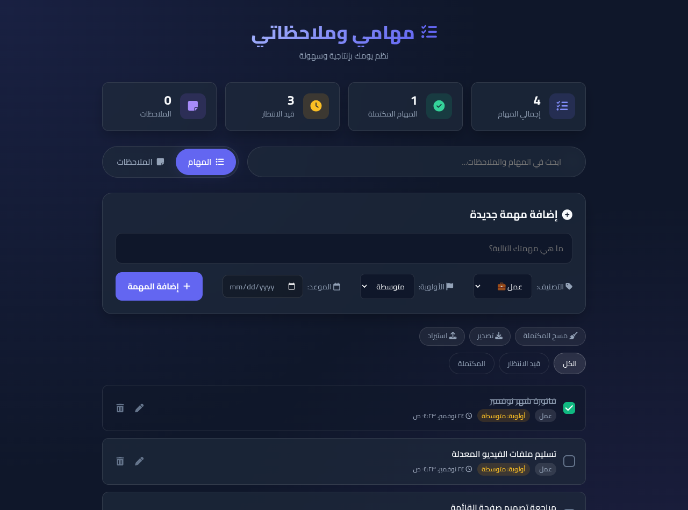

# Tasks & Notes App

_Screenshot with sample tasks entered through the page._

A small browser app for tracking daily tasks and short notes. Arabic interface (right-to-left). Plain HTML, CSS and JavaScript, no build step and no server.

## What it does
- Add tasks with a category, a priority and a due date; mark them done, edit them inline, clear finished ones
- Filter tasks (all, pending, done) and search tasks and notes
- Add and delete notes
- Counters for total, done and pending tasks
- Export your data to a JSON file and import it back (an invalid file is rejected and changes nothing)
- Everything is saved in your browser (localStorage). Nothing is sent anywhere.

## Run it
Open `my-first-app/index.html` in a browser, or from the repository root run `python3 -m http.server 8000` and open http://localhost:8000/my-first-app/

## Tests and limits
- Browser-tested in headless Chrome: 18 checks passed (add, blank rejected, complete, filters, search, edit, clear done, export, valid and invalid import, HTML in tasks and notes shown as text, persistence, mobile layout). The test scripts are not included in this repository.
- The fonts and icons load from Google Fonts and cdnjs, so without internet the page still works but uses fallback fonts and shows no icons.
- Data lives only in the browser it was entered in; clearing site data removes it.
