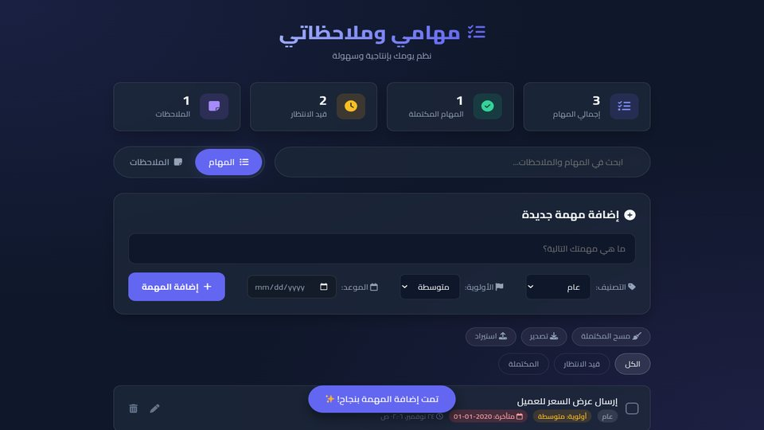

# Tasks & Notes App

A small browser app for tracking daily tasks and short notes. Arabic interface (right-to-left). Plain HTML, CSS and JavaScript, no build step and no server.

_Screenshot from a local run._

## What it does
- Add tasks with a category, a priority and a due date; mark them done, edit them, clear finished ones
- Add and search notes
- Counters for total, done and pending tasks
- Export your data to a file and import it back
- Everything is saved in your browser (localStorage). Nothing is sent anywhere.

## Run it
Open `my-first-app/index.html` in a browser, or from the repository root run `python3 -m http.server 8000` and open http://localhost:8000/my-first-app/

## Limits
- Data lives only in the browser it was entered in; clearing site data removes it.
- Not tested on every browser. Automated tests are not included in this repository.

Built by Mahamed Yasser.
